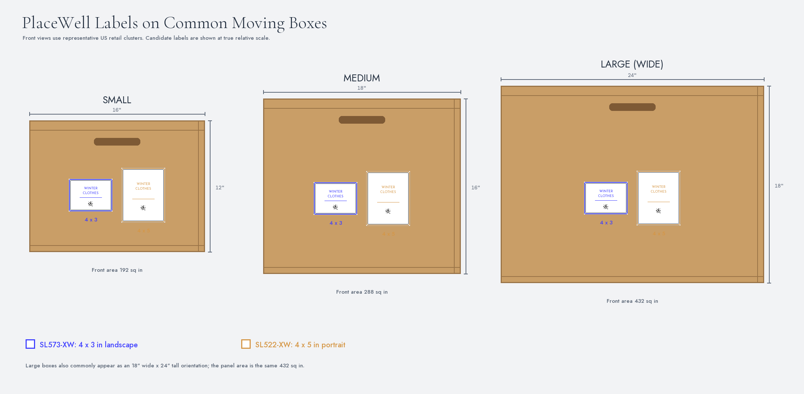
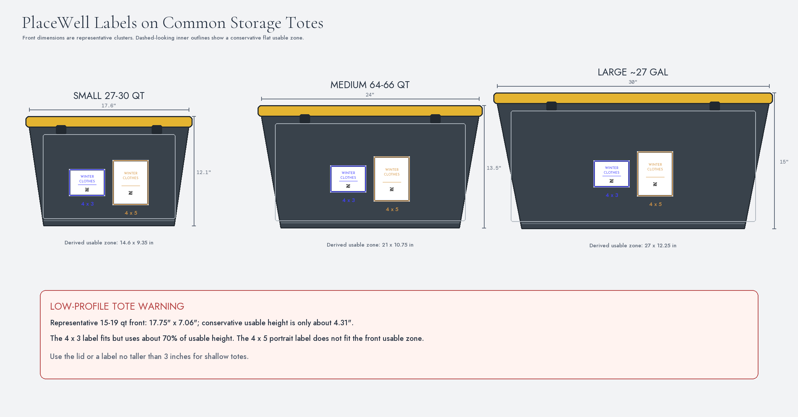
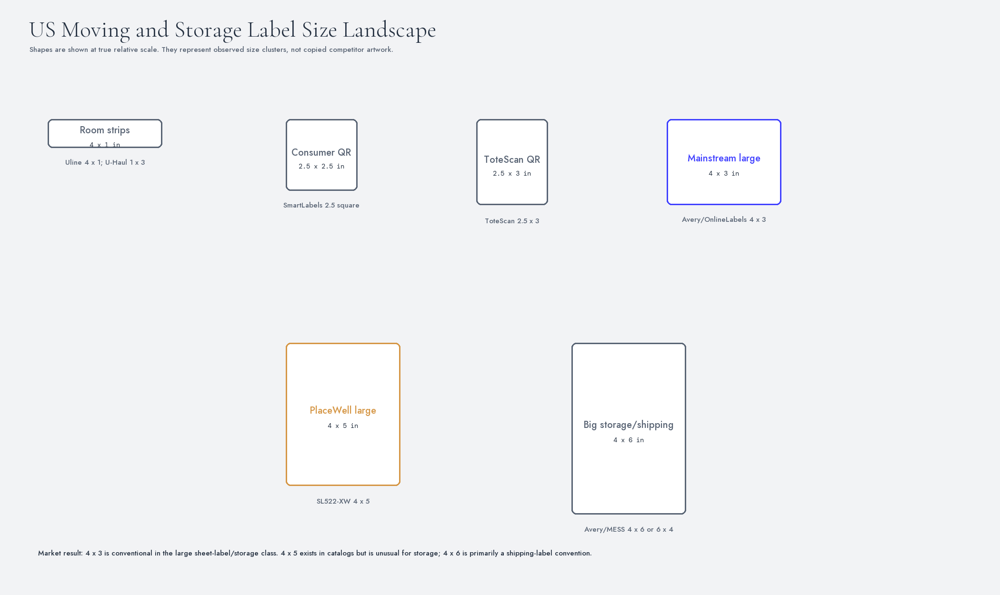

# US Moving Box and Storage Tote Label Size Comparison

Research date: 2026-10-28

Status: Market and dimensional research only. No implementation changes were
made.

Related research:

- `SheetLabels_Box_Tote_SKU_Research.md`
- `PlaceWell_New_Label_SKU_Change_Impact.md`
- `poc\box-tote-labels\README.md`

## Executive conclusion

There is no single US standard for moving-box or storage-tote labels.

However:

- Regular moving boxes form clear size clusters:
  - Small: approximately 16 x 12-inch front
  - Medium: approximately 18 x 16-inch front
  - Large: either 24 x 18 landscape or 18 x 24 portrait
- Storage totes vary much more because of capacity, taper, lids, ribs, latches,
  handles, and recessed panels.
- A **4 x 3 landscape label** is a conventional large sheet-label/storage
  format and fits every representative box and regular tote class.
- A **4 x 5 portrait label** fits ordinary moving boxes and regular
  cube/medium/large totes but is too tall for many shallow 15-19 quart tote
  fronts.
- Competitors cluster around:
  - 1 x 3 to 4 x 1 room strips
  - 2.5-inch QR labels
  - 3 x 4 / 3.33 x 4 / 4 x 3 large organization labels
  - 4 x 6 "big" labels, strongly associated with shipping
- 4 x 5 exists in label catalogs but is unusual as a storage-specific format.

Market-informed recommendation:

1. Use **SL573-XW (4 x 3 landscape)** as the leading general-purpose candidate.
2. Keep **SL522-XW (4 x 5 portrait)** as a differentiated large/long-content
   candidate.
3. Physically test both before selecting one launch SKU.
4. Do not describe either as a 4 x 6 shipping-label replacement.

## 1. Visual comparisons

### Moving boxes



### Storage totes



### Competitor size landscape



The label artwork in these images is conceptual. Box/tote dimensions and label
outlines are drawn at true relative scale within each image. The QR is shown at
PlaceWell's current 0.5-inch production size.

## 2. Regular US moving-box sizes

Retailers do not use a legally standardized small/medium/large system, but
major products cluster tightly.

### Major-retailer products

| Retailer | Class | Stated dimensions | Derived normal front face | Official page |
|---|---|---|---|---|
| U-Haul | Small | 16-3/8 x 12-5/8 x 12-5/8 in (L x W x H) | 16.375 x 12.625 | https://www.uhaul.com/MovingSupplies/Boxes/Standard-Sized-Moving-Boxes/Small-Moving-Box/?id=3245 |
| U-Haul | Medium | 18-1/8 x 18 x 16 in | 18.125 x 16 | https://www.uhaul.com/MovingSupplies/Boxes/Standard-Sized-Moving-Boxes/Medium-Moving-Box/?id=2793 |
| U-Haul | Large | 18 x 18 x 24 in | 18 x 24 portrait | https://www.uhaul.com/MovingSupplies/Boxes/Standard-Sized-Moving-Boxes/Large-Moving-Box/?id=2753 |
| Home Depot | Small | 16 x 12 x 12 in | Approximately 16 x 12 | https://www.homedepot.com/p/The-Home-Depot-Small-Moving-Box-16-in-L-x-12-in-W-x-12-in-D-1001004/202029361 |
| Home Depot | Medium | 18 x 18 x 16 in | Approximately 18 x 16 | https://www.homedepot.com/p/The-Home-Depot-Medium-Moving-Box-18-in-L-x-18-in-W-x-16-in-D-1001005/202029360 |
| Home Depot | Large | 18 x 18 x 24 in | Approximately 18 x 24 portrait | https://www.homedepot.com/p/The-Home-Depot-Large-Moving-Shipping-Packing-Box-1001006/202029359 |
| Lowe's | Small | 16 W x 12 H x 12 D in | 16 x 12 | https://www.lowes.com/pd/16-in-W-x-12-in-H-x-12-in-D-moving-box-Classic-Small-Cardboard-Moving-Boxes-with-Handle-Holes/3265367 |
| Lowe's | Medium | 18 W x 16 H x 18 D in | 18 x 16 | https://www.lowes.com/pd/18-in-W-x-16-in-H-x-18-in-D-Moving-Box-Classic-Medium-Cardboard-Moving-Boxes-with-Handle-Holes/3265417 |
| Lowe's | Large | 24 W x 18 H x 18 D in | 24 x 18 landscape | https://www.lowes.com/pd/lowe-s-24-0-in-w-x-18-0-in-h-x-18-in-d-classic-large-cardboard-moving-box-with-handle-holes/3265419 |

U-Haul pages were fetched directly. Home Depot and Lowe's pages were blocked
by bot protection during research; dimensions were read from their official
product titles/search results and should be rechecked in a normal browser
before procurement.

The UPS Store also lists common sizes such as 12 x 12 x 12, 16 x 16 x 16,
18 x 18 x 18, 20 x 12 x 12, and 24 x 18 x 18:

https://www.theupsstore.com/pack-ship/moving-boxes-supplies

### Defensible representative fronts

| Class | Representative front | Why |
|---|---:|---|
| Small | **16 x 12 in** | Home Depot and Lowe's match; U-Haul is the same nominal class with a slightly larger exterior measurement |
| Medium | **18 x 16 in** | Tight agreement across all three retailers |
| Large, wide | **24 x 18 in** | Lowe's and common heavy-duty orientation |
| Large, tall | **18 x 24 in** | U-Haul/Home Depot standard orientation |

The two large orientations have the same 432-square-inch panel and differ only
in which dimension is vertical.

### Usable box area

Derived conservative assumptions:

- Reserve approximately 1 inch at top for flap/fold/tape effects.
- Reserve approximately 0.5 inch at bottom.
- Reserve approximately 0.5 inch on each vertical side for corner creases and
  the manufacturer's joint.
- Avoid handle holes when labeling an end panel.

| Nominal front | Approximate usable zone | Usable area |
|---|---:|---:|
| 16 x 12 | 15 x 10.5 | 82% |
| 18 x 16 | 17 x 14.5 | 86% |
| 18 x 24 | 17 x 22.5 | 88% |
| 24 x 18 | 23 x 16.5 | 88% |

These are design assumptions, not manufacturer measurements.

## 3. How both PlaceWell labels fit moving boxes

| Box front | SL573 4x3: width/height share | SL522 4x5: width/height share | Result |
|---|---|---|---|
| Small 16 x 12 | 25% / 25% | 25% / 41.7% | Both fit; 4x5 is visually prominent |
| Medium 18 x 16 | 22.2% / 18.8% | 22.2% / 31.3% | Both fit comfortably |
| Large tall 18 x 24 | 22.2% / 12.5% | 22.2% / 20.8% | Both fit; either can look modest on the panel |
| Large wide 24 x 18 | 16.7% / 16.7% | 16.7% / 27.8% | Both fit; 4x3 looks compact |

Conclusions:

- Both candidates fit every regular moving-box class.
- 4x3 is sufficient for a room/content label and is consistent with market
  expectations.
- 4x5 provides more visual hierarchy or content space, but it occupies almost
  half the height of a small box.
- On large boxes, even 4x5 is not physically dominant; visibility depends more
  on typography and contrast than raw coverage.

## 4. Regular US storage-tote sizes

Totes do not form a simple standard. Capacity does not uniquely predict front
shape: some totes are shallow and wide, while others are taller and cube-like.

The front face below means the long side with the lid installed.

### Small low-profile totes: approximately 15-19 quarts

| Product | Capacity | Exterior dimensions (L x W x H) | Front | Official page |
|---|---:|---:|---:|---|
| Sterilite Latch Box | 15 qt | 17.125 x 11.25 x 6.5 | 17.125 x 6.5 | https://www.sterilite.com/product/15-qt-latch-box/ |
| Sterilite Stacker | 16 qt | 18 x 12.625 x 7.125 | 18 x 7.125 | https://www.sterilite.com/product/16-qt-stacker-box/ |
| Sterilite Ultra Latch | 18 qt | 18.125 x 12.25 x 7 | 18.125 x 7 | https://www.sterilite.com/product/18-qt-ultra-latch-box/ |
| IRIS Remington Weathertight | 19 qt | 17.5 x 11.75 x 7.88 | 17.5 x 7.88 | https://www.irisusainc.com/products/remington-weathertight-heavy-duty-storage-tote-19qt-6pk-2 |

Representative front: **17.75 x 7.06 in**

### Small cube-like totes: approximately 27-30 quarts

| Product | Capacity | Exterior dimensions | Front | Official page |
|---|---:|---:|---:|---|
| Sterilite Latch Box | 27 qt | 17.125 x 11.25 x 12.625 | 17.125 x 12.625 | https://www.sterilite.com/product/27-qt-latch-box/ |
| Sterilite Ultra Latch | 30 qt | 18.125 x 12.25 x 11.5 | 18.125 x 11.5 | https://www.sterilite.com/product/30-qt-ultra-latch-box/ |
| Sterilite Stacker | 30 qt | 18 x 12.625 x 13.25 | 18 x 13.25 | https://www.sterilite.com/product/30-qt-stacker-box/ |

Representative front: **17.6 x 12.1 in**

### Medium totes: approximately 56-76 quarts

Representative official products:

| Product | Capacity | Exterior dimensions | Front | Official page |
|---|---:|---:|---:|---|
| Sterilite Latching Box | 64 qt | 23.75 x 16 x 13.5 | 23.75 x 13.5 | https://www.sterilite.com/product/64-qt-latching-box/ |
| Sterilite Latch Box | 66 qt | 24 x 16 x 13.875 | 24 x 13.875 | https://www.sterilite.com/product/66-qt-latch-box-2/ |
| Sterilite Ultra Latch | 70 qt | 26.125 x 16.25 x 13.5 | 26.125 x 13.5 | https://www.sterilite.com/product/70-qt-ultra-latch-box/ |
| IRIS Stack & Pull | 72 qt / 18 gal | 25.63 x 16.63 x 13.25 | 25.63 x 13.25 | https://www.irisusainc.com/products/stack-pull-storage-box-4-pack-18-gal-72-qt |
| IRIS WeatherPro | 74 qt | 23.6 x 17.75 x 14.5 | 23.6 x 14.5 | https://www.irisusainc.com/products/storage-container-weatherpro-74-qt-gasket-box |

Representative front: **24 x 13.5 in**

### Large totes: approximately 27 gallons / 105-116 quarts

| Product | Capacity | Exterior dimensions | Front | Official page |
|---|---:|---:|---:|---|
| Sterilite Latch Box | 105 qt | 32.125 x 19.125 x 13.75 | 32.125 x 13.75 | https://www.sterilite.com/product/105-qt-latch-box/ |
| Sterilite Ultra Latch | 116 qt | 33 x 20.125 x 13.5 | 33 x 13.5 | https://www.sterilite.com/product/116-qt-ultra-latch-box/ |
| Sterilite Industrial Tote | 27 gal | 28.5 x 19.625 x 15.5 | 28.5 x 15.5 | https://www.sterilite.com/product/27-gal-industrial-tote-4/ |
| IRIS Heavy Duty | 27 gal / 108 qt | 30.25 x 20.25 x 14.25 | 30.25 x 14.25 | https://www.irisusainc.com/products/heavy-duty-storage-bins-4-pack-27-gal-108-qt |
| Rubbermaid Commercial BRUTE | 20 gal | 27.88 x 17.38 x 15.13 | 27.88 x 15.13 | https://www.rubbermaidcommercial.com/material-handling/storage/brute-totes-with-lid/ |

Representative front: **30 x 15 in**

## 5. Tote usable-area constraints

Nominal front dimensions overstate the flat label area because totes have:

- Lid skirts and overhangs
- Latches
- Handles
- Corner radii
- Tapered walls
- Base ribs
- Recessed panels
- Molded branding
- Textured or channeled walls

Conservative derived usable zone:

```text
usable width  = nominal width - 3 inches
usable height = nominal height - 2.75 inches
```

| Representative tote | Nominal front | Derived usable zone |
|---|---:|---:|
| Small low-profile | 17.75 x 7.06 | 14.75 x 4.31 |
| Small cube-like | 17.6 x 12.1 | 14.6 x 9.35 |
| Medium | 24 x 13.5 | 21 x 10.75 |
| Large | 30 x 15 | 27 x 12.25 |

The formula is a design allowance, not a manufacturer specification. Measure
real totes before approving production placement.

## 6. How both PlaceWell labels fit totes

| Tote | SL573 4x3 | SL522 4x5 | Result |
|---|---|---|---|
| Small low-profile | Fits, but consumes about 70% of usable height | Does not fit the conservative front zone | Use 4x3 or place label on lid |
| Small cube-like | Fits comfortably | Fits; consumes about 54% of usable height | Both viable |
| Medium | Fits comfortably | Fits; about 47% of usable height | Both viable |
| Large | Fits comfortably but can look compact | Fits; about 41% of usable height | Both viable; typography must remain bold |

Conclusion:

- **4x3 is universal across the tested regular classes.**
- **4x5 excludes many shallow totes as a front-face label.**
- For shallow totes, the lid may be the better application surface.
- On large totes, neither candidate is oversized.

## 7. Competitor label market

No single competitor dimension dominates the entire storage/moving market.

### Moving-room/content stickers

| Brand/product | Size | Positioning | Source |
|---|---:|---|---|
| U-Haul Moving Labels | 1 x 3 | Preprinted room/handling strips | https://www.uhaul.com/MovingSupplies/Moving-Lifting-Tools/Moving-Tools/Moving-Labels/?id=2824 |
| Uline Moving Labels - Home | 4 x 1 | Preprinted room strip | https://www.uline.com/Product/Detail/S-7334/Shipping-and-Handling-Labels/Moving-Labels-Home |
| uBoxes Moving Labels | 4.5 x 1 | Color-coded room strip | https://www.uboxes.com/moving-tips/moving-labels |
| Scotch storage/moving label | Approximately 4.62 x 2.87 | Writable moving/storage label | https://www.walmart.com/ip/Scotch-Removable-Storage-Labels-2-87-x-4-62-White-50-Count/2757291870 |

These products are much smaller than either PlaceWell candidate.

### Mainstream large sheet labels

| Product | Size | Typical use | Source |
|---|---:|---|---|
| Avery 5164 / 8164 | 3.33 x 4 | Shipping/address/large sheet label | https://www.avery.com/products/labels/5164 |
| Avery Presta 94252 | 4 x 3 | Four-inch landscape template | https://www.avery.com/templates/94252 |
| Avery 5168 | 3.5 x 5 | Large shipping/address label | https://www.avery.com/products/labels/5168 |
| Avery Presta 94253 | 4 x 5 | Catalog template, not storage-positioned | https://www.avery.com/templates/94253 |

### Storage/tote labels

| Product | Size | Material/claim | Source |
|---|---:|---|---|
| Avery 5453 | 3 x 4 | Removable paper; boxes/packages | https://www.avery.com/products/labels/5453 |
| Avery 5454 / 5614 | 4 x 6 | Removable paper; large storage label; not recommended for plastic/textured/water-resistant surfaces | https://www.avery.com/products/labels/5454 |
| Avery Presta 94252 removable | 4 x 3 | Removable matte paper; storage bins | https://www.walmart.com/ip/Avery-Removable-Rectangle-Labels-4-x-3-60ct/5117566154 |
| MESS reusable labels | 3 x 4 | Removable vinyl/dry-erase | https://www.messbrands.com/product/reusable-and-erasable-labels-for-food-containers-48-pack-3x4/ |
| MESS large bin label | 6 x 4 | Marketplace tote/storage product | https://www.walmart.com/ip/MESS-Removable-Storage-Bin-Labels-6-x-4-Orange-50-Count/5381965452 |

Marketplace facts change quickly and several listings contain conflicting
attribute fields. Official manufacturer pages are more reliable.

### QR-enabled organization competitors

| Product | Size | Positioning | Source |
|---|---:|---|---|
| SmartLabels | 2.5 x 2.5 | Consumer QR inventory labels | https://www.qrsmartlabels.com/products/smart-labels-original-red-green-blue-yellow |
| ToteScan | 2.5 x 3 | QR labels for moving/storage | https://www.walmart.com/ip/ToteScan-Intelligent-QR-Labels-for-Organization-Moving-Storage-45-Unique-Labels-2-5-x3/486076227 |
| Sortly supported "Large" | 3.33 x 4 | Inventory label with QR, ID, name, notes | https://help.sortly.com/choosing-the-right-labels-in-sortly |

PlaceWell's 4x3 and 4x5 candidates are larger than typical consumer QR labels.

## 8. Observed market size clusters

| Size cluster | Examples | Market role |
|---|---|---|
| 1x3 to 4.5x1 | U-Haul, Uline, uBoxes | Preprinted room/handling strips |
| 2x4, 3x2, 2.5-square to 2.5x3 | Avery small labels, SmartLabels, ToteScan | Small writable or QR labels |
| **3x4, 3.33x4, 4x3** | Avery, OnlineLabels, MESS, Sortly | Mainstream large organization/sheet label |
| 3.5x5, **4x5** | Avery catalog, OnlineLabels, JAM | Product/address/shipping; uncommon for storage |
| 4x6 / 6x4 | Avery large storage, MESS, thermal labels | Big storage and carrier shipping convention |

Interpretation:

- **4x3 is conventional**, even when competitors call the nearby format
  3x4 or 3.33x4.
- **4x5 is available but differentiated**; it is not a common moving/storage
  product size.
- **4x6 is familiar to customers**, but that familiarity comes largely from
  shipping labels and thermal printers.

## 9. PlaceWell candidate comparison

| Factor | SL573-XW 4x3 | SL522-XW 4x5 |
|---|---|---|
| Orientation | Landscape | Portrait |
| Labels per Letter sheet | 6 | 4 |
| Label area | 12 sq in | 20 sq in |
| Letter-sheet label-area utilization | 77% | 86% |
| Market familiarity | Strong: aligns with 3x4/3.33x4/4x3 cluster | Low for storage; differentiated |
| Box fit | Fits every regular box class | Fits every regular box class |
| Tote fit | Fits shallow through large classes | Does not fit many shallow tote fronts |
| QR/content space | Ample for PlaceWell name and 0.5-inch QR | Very large; supports more information |
| Unit yield | Better | Lower |
| Positioning | General-purpose storage/moving | Premium large-detail/high-visibility |

The SheetLabels research snapshot found that cost per square inch is nearly the
same. The commercial choice is therefore about physical fit and product
positioning, not a material-value advantage.

## 10. Material differentiation

PlaceWell's XW material is laser-only matte white weatherproof polyester.

Potential advantages:

- More durable than ordinary paper moving stickers.
- Better suited to moisture and handling.
- Current QR output can remain vector K-only.

Risks:

- Polyester rigidity on curves/textures.
- Unknown long-term adhesion to specific PP/PE tote plastics.
- Permanent adhesive may leave residue on reusable totes.
- Laser-only material excludes customers expecting to print it themselves on
  an inkjet.

Competitor context:

- Avery's large removable 4x6 storage label explicitly says it is not
  recommended for plastic, textured, scratch-resistant, or water-resistant
  surfaces.
- Avery permanent 5164 claims adhesion to cardboard and plastic.
- MESS's large vinyl listing targets plastic/glass but is marketplace-sourced.

PlaceWell should differentiate on validated weatherproof tote/box performance,
not merely on being larger.

## 11. Recommendation

### Core launch candidate: SL573-XW 4x3

Reasons:

- Fits every representative moving-box and tote class.
- Aligns with the mainstream 3x4/3.33x4/4x3 large-label cluster.
- Six labels per sheet.
- Lower unit cost than 4x5.
- Enough area for a large name, current QR, and restrained secondary text.
- Less likely to collide with tote lids, latches, or base ribs.

### Secondary candidate: SL522-XW 4x5

Use if physical tests show a real need for:

- Longer content lists
- Greater visual prominence
- Large box faces
- Medium/large totes only
- Premium differentiated format

Do not select 4x5 as the only general-purpose SKU unless shallow totes are
explicitly out of scope.

### Do not add 4x6 yet

4x6 is a shipping-label convention and inefficient on Letter sheets. If
customer demand specifically asks for 4x6, treat it as a separate thermal/large
label product class rather than silently replacing either SheetLabels
candidate.

## 12. Required physical validation

Before final selection:

1. Obtain SL573-XW and SL522-XW samples.
2. Test on:
   - Small/medium/large corrugated boxes
   - Shallow tote
   - 27-30 qt tote
   - 64-66 qt tote
   - 27-gallon tote
3. Measure the actual flat front zones.
4. Test adhesion at 24 hours, 72 hours, and 7 days.
5. Test smooth and textured PP/PE.
6. Check residue/removal if reusable totes are in scope.
7. Print one, three, and ten consecutive sheets.
8. Verify all sheet positions, registration, QR scanning, curl, scuffing, and
   feed reliability.
9. Place printed labels on real containers and photograph them at realistic
   viewing distances.
10. Compare competitor samples physically where marketplace dimensions or
    adhesive claims are inconsistent.

## 13. Research reliability

Highest-confidence sources:

- U-Haul official product pages
- Sterilite official product pages
- IRIS official storefront pages
- Rubbermaid Commercial
- Avery official product/template pages
- Uline
- SheetLabels
- Sortly Help
- SmartLabels official page
- MESS direct page

Medium-confidence sources:

- Home Depot and Lowe's dimensions obtained from official titles/search
  results when direct pages were blocked
- Walmart marketplace listings

Do not treat derived usable zones, marketplace dimensions, or adhesive
performance as manufacturing specifications. They are inputs to physical
testing.
